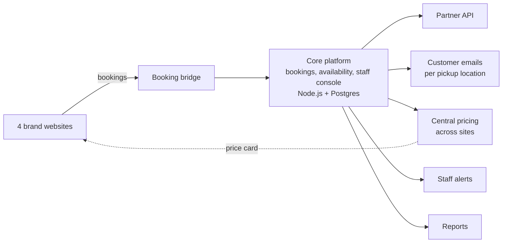

# CaravelWay: how it is built

CaravelWay is the in-house booking and back-office platform of Caravel Rent a Car, a car rental
company in Crete handling around 10,000 reservations a year. It replaced a WordPress booking
setup and a lot of manual work. Every brand website's bookings flow into it and every price comes from
it; staff run the desk, confirmations, alerts and reports from one console; and travel companies
connect through a partner API. This repository is a write-up, not the source code.

## Architecture

The core is multi-tenant: each rental operator's data is isolated by Postgres row-level security.

## What runs automatically

| Flow | Before | Trigger | What it does now |
|---|---|---|---|
| Confirm or cancel | Website bookings accepted as confirmed, unchecked | Every 30 min, daytime only | Emails the customer 5 days before pickup; 2 days before, a reminder email and SMS. Silence never cancels: staff decide. [Spec](docs/confirm-or-cancel-spec.md) |
| Location-specific emails | One generic confirmation | Every booking email | Adds the pickup station's own directions, images and files, under the customer's brand. Switchable per station |
| Pickup alerts | Same-day bookings spotted in the list | Every 15 min; every minute at night | Push and email to staff for a booking made today with pickup within hours. Each booking alerts once |
| Digital agreements | Paper and pen | At the desk | Contract signed on screen, its content fixed by a hash, evidence stored, copy emailed. Rollout in progress |
| Review requests | A spreadsheet and a script | Day after drop-off | Asks every customer once, with one reminder, linking to the right review site. Opt-outs are absolute |
| Central pricing | Each site's prices edited separately | Every few minutes | Sites pull their price card and fall back to their own prices if the platform goes quiet. Site prices are never overwritten |

## How it's built

I am the product owner. AI coding agents build the platform, working to written rules:

- **Claude Code** is the main builder, co-author of most of the ~1,800 commits.
- **OpenAI Codex** is a second builder.
- Model APIs from **Anthropic**, OpenAI and Google run an independent review council.

The process:

- **Spec first.** Decisions are written in plain language before code: about 230 logged decisions
  and 90 design documents.
- **Automated tests.** About 1,200 test files against a real database, plus golden, property and
  mutation tests on the money code. Required CI checks gate every change.
- **Review scaled to risk.** The files a change touches decide how much independent review it needs.
  Findings are verified against the code, not taken on trust.
- **Human-only deploys.** Agents have no production access. A person presses the deploy button, and
  it refuses anything not green.
- **Live migration in peak season.** In July 2026 production moved from SQLite to Postgres: the two
  ran side by side and were compared, then switched atomically. No bookings were lost.

Details: [docs/ai-workflow.md](docs/ai-workflow.md). Sanitized code excerpts: [examples/](examples/)
(run `node --test examples/`).

## Partner API

Public documentation: **[api.caravelway.com/docs/packs/caravel](https://api.caravelway.com/docs/packs/caravel/)**

- **37 operations:** reference data, availability, quotes, booking lifecycle, settlements,
  credentials and webhook settings, plus signed booking webhooks.
- **Sandbox:** two test suppliers behind one key.
- **Certification:**
  - a recorded ten-phase run, which serves the partner's real client shapes it has never seen
    (unknown fields and codes, re-issued IDs, a shrunken catalogue) and checks that it keeps working;
  - 29 certification checks, 17 of them measured automatically from sandbox traffic.

## What's not here and why

The source code, business logic and data stay private; this repository shows how the platform is
built, not what it contains.

---

All rights reserved. No license is granted to copy, modify or reuse anything in this repository.
