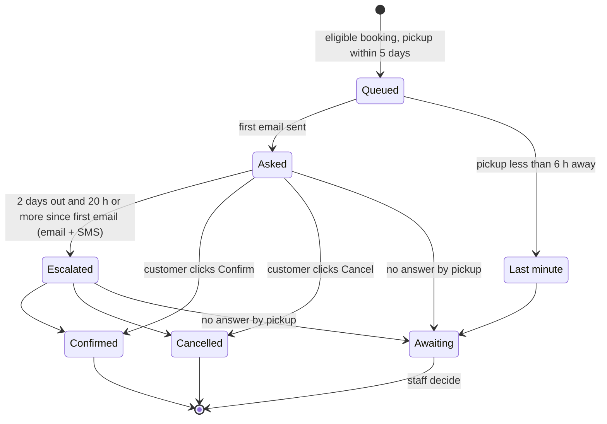

# Confirm-or-cancel: specification

*A cleaned-up version of the real requirements behind CaravelWay's confirm-or-cancel flow. Provider
names, internal identifiers and anything commercially sensitive have been removed or generalized.
The timings are the real defaults; every one of them is configuration, not code.*

## 1. The problem

A booking made on one of the brand websites arrives as **pending**. Some customers book with more
than one company, or change their plans, and never say so. The car then sits reserved for someone
who will not arrive, while it could have been rented to someone else.

Goal: before pickup, ask every eligible customer one simple question, "keep or cancel?", in a way
that is easy to answer, never annoying, and never takes a decision on the customer's behalf.

## 2. Who is in the cycle

A booking enters the cycle only if **all** of these hold:

| Rule | Why |
|---|---|
| Status is *pending* and the customer has not answered yet | The question only makes sense for an open booking |
| It has a customer email address | Email is the reliable channel |
| It did **not** come from a B2B partner | The partner owns that customer relationship; we never contact their customers |
| It came from a brand website, **or** staff ticked "send confirm/cancel" on a desk booking | Phone and walk-in bookings are opt-in, per booking |
| It was created after the feature went live, **or** staff explicitly opted it in | The existing backlog was never mass-emailed on launch day |
| Automated email is switched on for its pickup station | Staff can mute all automated messages per station |

This rule has **one definition** in the code, read by both the sender and the staff dashboard, so the
dashboard can never show a different set of bookings from the set that actually gets emailed.

## 3. Timeline

| When (before pickup) | What happens | Condition |
|---|---|---|
| 5 days | Email: "Please confirm or cancel your booking" with two buttons | Sent once. "Within 5 days" rather than "exactly 5", so a missed day still sends |
| 2 days | Reminder email **and** SMS | Only if still unanswered and at least 20 hours after the first email |
| Less than 6 hours | Nothing is sent; the booking stays pending for staff | Last-minute bookings: the customer has just booked, so asking adds nothing |
| No answer at all | Booking **stays pending** and shows as "awaiting" for staff | Never cancelled automatically |

Further rules:

- **Send window:** messages only go out between 08:00 and 22:00 local time. Nobody gets a booking
  email at 03:00.
- **Check frequency:** the scheduler checks every 30 minutes. Running it more often never causes a
  duplicate, because every message is stamped when it is sent.
- **One message per booking per pass:** the first email and the reminder are never sent in the same pass.

## 4. States

The booking itself has only three statuses that matter here: *pending*, *confirmed*, *cancelled*. The
cycle's own progress is tracked separately, one timestamp per message (first email, reminder email,
reminder SMS) plus an outcome on the first email (*sent*, *failed*, *skipped as last-minute*).

## 5. The customer's link

- Each email carries a **single-use link**. The secret in the link is stored only as a hash, the
  same model as a password-reset link, and it expires shortly after the decision window closes.
- Opening the link shows the booking and two buttons. **Opening never changes anything**; only
  pressing a button does. Email security scanners and link previews open links automatically, and
  must never confirm or cancel a booking by accident.
- If the customer clicked "Cancel" in the email, the page heading says "Cancel your booking?", but
  they still have to press the button.
- Answering once uses up every outstanding link for that booking. The other email's link then shows
  "You've already responded".
- The SMS uses a shorter link that leads to the same page.

| What the customer sees | When |
|---|---|
| Confirm / Cancel buttons | Valid link, booking still pending |
| "Thank you, your booking is confirmed" / "Your booking has been cancelled" | After pressing a button |
| "You've already responded" (with the current answer) | Second click, either link |
| "This link has expired" | Past the expiry |
| "This booking is no longer pending, please call us" | Staff already changed it |
| "This reservation has been archived" | After the privacy-retention window, when the record is frozen |
| "This link is not valid" | Unknown or mistyped link |

The status change is a single conditional update: it only succeeds if the booking is *still*
pending at that instant. If staff changed it a moment earlier, the customer gets the "no longer
pending" message instead of overriding them. A short acknowledgement email follows the decision.

## 6. Delivery rules

The two channels deliberately follow **opposite** retry rules.

| | Email | SMS |
|---|---|---|
| Cost | Free | Paid per message |
| Order | Send, then record it | Record (claim) it, then send |
| On a temporary failure (rate limit, server error, network) | Not recorded, so the next pass retries | Never retried |
| On a permanent rejection (e.g. invalid address) | Recorded as failed, so it stops trying; booking stays pending | Not retried; link kept if delivery is uncertain |
| Guarantee | Delivered at least once | Sent at most once, never charged twice |

Why: an SMS timeout is ambiguous, because the provider may have delivered it anyway. Retrying could
send it twice and pay twice. Email is the reliable channel; the SMS is a nudge on top.

More SMS rules:

- Only sent to numbers in full international format with a known country code. The system never
  guesses a country for a local-looking number.
- The message fits in one SMS segment and the link is never cut off.
- A cap per pass limits the burst when SMS is first switched on, when every waiting booking becomes
  eligible at once. The rest roll over to the next pass.
- SMS shipped **switched off** behind its own switch, so it is enabled only after a controlled test.

## 7. Exceptions

| Situation | Behaviour |
|---|---|
| Customer never answers | Stays pending, flagged "awaiting" for staff. Never cancelled automatically |
| Pickup is less than 6 hours away when the booking is first seen | No messages at all; marked once as last-minute for the record |
| A pickup at 01:00, first email already sent the day before | No reminder that evening (otherwise it would arrive after pickup). Found in review and covered by a dedicated regression test |
| Staff confirm or cancel the booking first | The customer's link refuses to override and asks them to call |
| Email provider rejects the address | Marked failed once; the booking stays pending for staff |
| One booking causes an error | Logged; the pass continues with the next booking |
| One operator's pass fails | Logged; the other operators' reminders still go out |
| The configured send window is empty or inverted | Falls back to "from start hour to midnight" and logs loudly, instead of silently sending nothing |
| Station's automated email is switched off | No email and no SMS for bookings at that station |

## 8. Controls for the business

| Control | Effect |
|---|---|
| Global pause | Stops the whole cycle: nothing sent, nothing recorded. Used while testing a change. Even a forced run respects it |
| Per-station switch | Mutes all automated messages for one pickup station |
| Per-booking opt-in | Brings a desk booking, or an older booking, into the cycle |
| SMS switch | Turns the SMS escalation on or off |
| Send window, lead time, check frequency | Adjustable without a code change |

## 9. What staff see

A dashboard with four counters (**queued**, **awaiting**, **confirmed**, **cancelled**) and a list,
soonest pickup first, showing each booking's place in the cycle and whether its SMS was delivered.
What happens to an "awaiting" booking stays a staff decision.

## 10. How it was verified

- Automated tests for the scheduler, the links and the email and SMS sends, including a frozen test
  clock so results never depend on what time the suite runs. The first version shipped with 28 cycle tests and
  11 email-rendering tests; the SMS step added a further 58 assertions.
- Every change was reviewed by an independent panel of AI models from different labs, with findings
  checked against the code before being accepted. The SMS step went through three review rounds.
- The SMS step was deployed switched off, separately from the email cycle.

## 11. How the requirements changed

| Date (2026) | Decision |
|---|---|
| 28 Jun | First version: emails 4 days and 2 days before pickup; never auto-cancel; backlog excluded |
| 28 Jun | First email moved to 5 days; per-station on/off switch; per-brand sender |
| 29 Jun | SMS added at the 2-day step, together with the email; partner bookings excluded; retry rules split by channel |
| 30 Jun | Send window widened (09–21 to 08–22) and made configurable; last-minute bookings skipped |
| 9 Aug | Desk bookings, including walk-ins, included when staff opt in |

Each change was written down as a plain-language decision first, then built, tested and reviewed.
